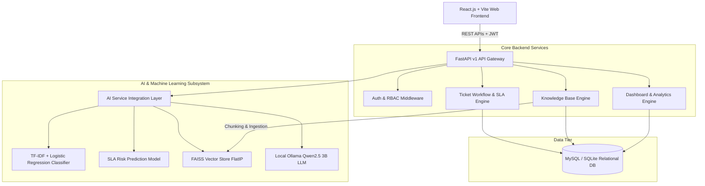
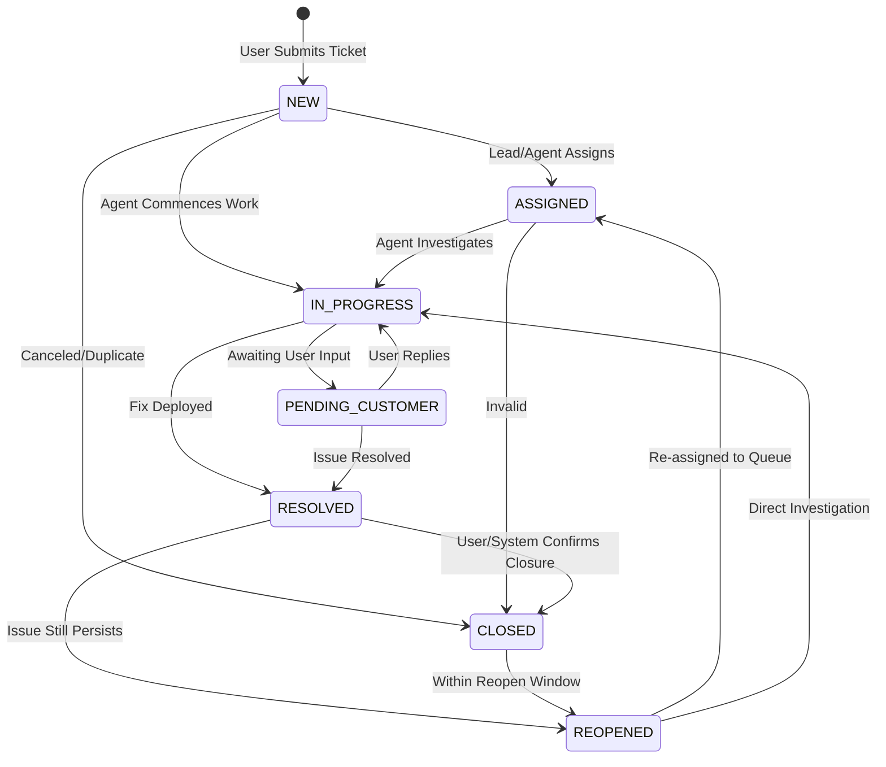
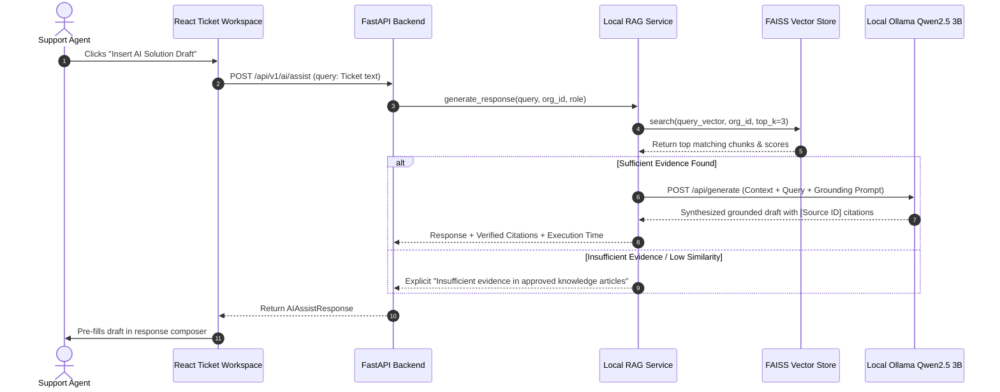

# System Architecture: AI-Based Smart Help Desk & Ticket Management System

## 1. High-Level Architecture Overview

The system is engineered as an enterprise-grade, multi-tenant solution designed for corporations and educational institutions. It tightly integrates a modern React frontend, a high-throughput Python FastAPI backend, a MySQL database, and a local AI/ML subsystem powered by scikit-learn, Sentence Transformers, FAISS, and Ollama.

---

## 2. Multi-Tenant Organization Isolation

Every critical entity in the system (`User`, `Ticket`, `Category`, `SLAPolicy`, `KnowledgeArticle`, `AuditLog`) is strictly scoped by `org_id` (UUID).

1. **Authentication Claims**: Upon authentication (`/api/v1/auth/login`), the JWT payload encapsulates `sub` (User ID), `org_id`, and `roles`.
2. **Access Control Verification**: Every repository query automatically enforces `WHERE org_id = current_user.org_id`.
3. **Cross-Tenant Guard**: Mismatched organization requests by non-SysAdmin users immediately trigger `403 Forbidden: Cross-organization access forbidden`.
4. **Vector Search Isolation**: In `KnowledgeVectorStore`, search queries accept the caller's `org_id`. Candidate vectors originating from other organizations are strictly discarded during similarity ranking.

---

## 3. Ticket Workflow State Machine

The ticket lifecycle follows an audited state machine preventing illegal status jumps:

Every transition records an immutable `TicketEvent` in `ticket_events` capturing the actor, previous state, new state, notes, and UTC timestamp.

---

## 4. Local RAG Pipeline Architecture

